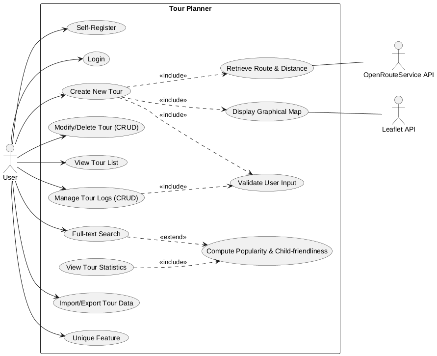
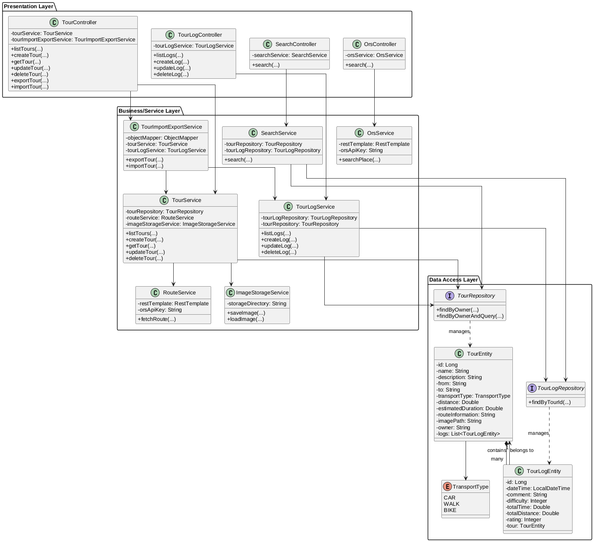
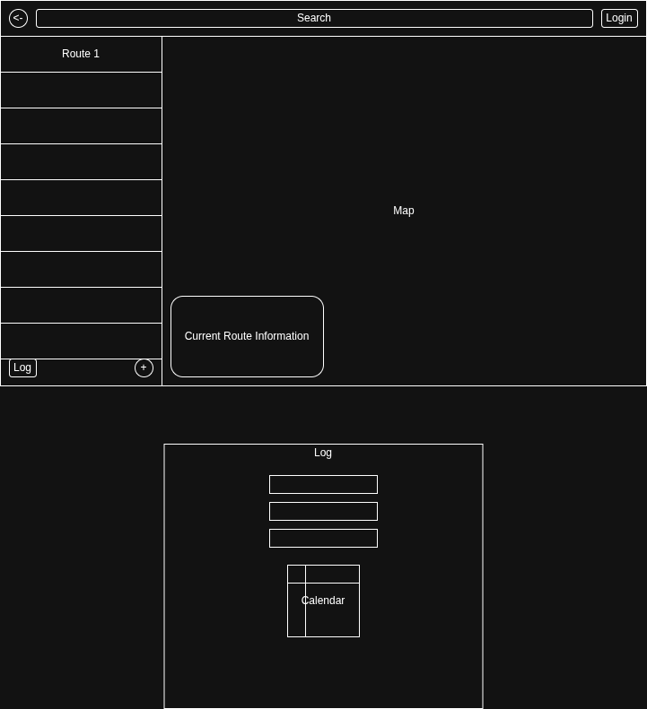
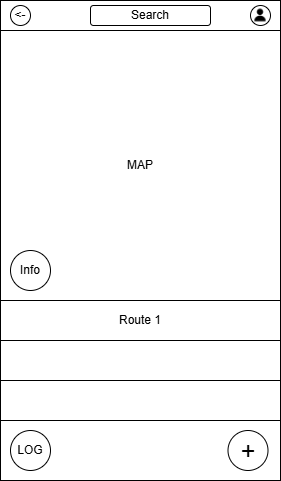

# TourPlanner Protocol

This document provides a summary of the technical decisions, features, and UI-flow for the TourPlanner project.

https://github.com/SWEN2-Routenplaner/SWEN2

## Technical Steps and Decisions

### Architecture & Frameworks
- **Frontend Framework:** Angular (v21) was selected for its robust component-based architecture and modern features like Signals. For additional components Angular Material was used to simplify the frontend development and unify the design of all components.
- **State Management:** A custom Signal-based store was implemented (e.g., `ToursStore`, `AuthStore`). This provides a reactive way to manage state without the complexity of NgRx.
- **Testing:** `vitest` is used for unit testing in the frontend and `Junit` in the backend.

### Design Decisions & Refactoring
- **Routing Structure:** Refactored from a flat structure to a hierarchical one with child routes under `/tours`. This allows for better organization of nested views like tour logs and editing.
- **Folder Organization:** The `tours` component directory was refactored to nest sub-components like `new-tour` and `saved-tours` within a `default` component for better encapsulation.
- **Navbar Refactoring:** The search bar was moved into a separate component to keep the navbar lean and improve modularity.
- **Mobile Support:** Implemented a responsive mobile navigation system to enhance accessibility on small screens.

### Failures and Selected Solutions
- **Invalid Route Access:** Encountered issues when users manually entered URLs for non-existent tour logs. 
    - *Solution:* Implemented guard-like logic in components to redirect users if a resource ID (e.g., `logId`) is not found.
- **Form State Management:** Initial tour creation forms were complex and hard to validate across many fields.
    - *Solution:* Standardized on Angular Reactive Forms with clear validation messages and visual feedback (e.g., changing colors for transport modes).
- **Navigation Complexity:** As more features were added, the navbar became cluttered.
    - *Solution:* Extracted the search feature into its own component and introduced a dedicated mobile navigation view.

## UML Use Case Diagram

## App Architecture

The app consists of a Spring Boot backend and an Angular frontend.

### Backend

The backend is split into 3 layers:

- **Presentation** – REST controllers and DTOs (what the API accepts and returns)
- **Business** – Services that contain the actual logic (e.g. `TourService`, `TourLogService`)
- **Data Access** – JPA entities and Spring Data repositories for database access

Controllers are kept thin and just call the matching service. The service handles things like checking if the user owns the tour before doing anything with it.

*(For the full version with complete method parameters, see [class_full.png](protocol/class_full.png))*

### Frontend

The frontend uses Angular with a Signal-based store pattern:

- **Services** – make HTTP calls to the backend
- **Stores** – hold the app state as Signals and call the services
- **Pages/Components** – read from the stores and display the data

## Unit Testing

We only unit tested the service layer, since that's where the actual business logic lives.
Controllers are too thin to be worth testing alone, and repositories are covered by Spring Data.

We used **JUnit 5 + Mockito** and mocked all dependencies (repositories, other services)
so no Spring context or database is needed.

Tested in `TourServiceTest`:
- listing tours with and without a search query
- creating a tour when the route service fails (should still save with placeholder values)
- getting/updating/deleting tours, including wrong owner and not found cases

Tested in `TourLogServiceTest`:
- listing, creating, getting, updating and deleting tour logs
- not found cases for both tours and logs

## Design Patterns

**Repository Pattern**
We use Spring Data repositories (`TourRepository`, `TourLogRepository`) so services
never write SQL directly. This also made mocking in tests straightforward.

**DTO Pattern**
JPA entities are never returned from the API directly. We map them to response records
(`TourResponse`, `TourLogResponse`) in the service layer, keeping the API and database schema independent.

**Facade (Service Layer)**
Controllers just figure out who the logged-in user is and call the service.
All actual logic (ownership checks, route calculation, etc.) lives in the service.

**RestControllerAdvice**
`GlobalExceptionHandler` catches exceptions like `ResourceNotFoundException` and
`AccessDeniedException` in one central place and turns them into proper HTTP error responses.

## UI-Flow (Wireframes)

The following flow describes the typical user interaction path:

### 1. Authentication Flow
- **Register/Login Page:** User enters credentials.
- **Success:** Redirects to **Home**.

### 2. Main Navigation
- **Navbar:** Provides links to **Home**, **Tours**, and **Profile**.
- **Search Bar:** Integrated into the Navbar for global tour searching.

### 3. Tour Management Flow
- **Home:** Overview and quick links.
- **Tours (Default View):** Shows a list of **Saved Tours** on the left and a **New Tour** form or selected tour details on the right.
- **New Tour:** Form with fields for `From`, `To`, `Transport Mode`, and `Description`. Includes ability to add intermediate stops.
- **Edit Tour:** Opens an edit form for an existing tour.

### 4. Log Management Flow
- **Saved Tour Item:** Click to view logs.
- **Tour Logs View:** Shows a list of logs for the selected tour.
- **Add/Edit Log:** Modal or sub-page to enter log details (date, duration, distance, etc.).

### Wireframe

### Mobile View

### Authentication (Authentik)
A functional integration between the Spring Boot backend and Authentik (OIDC) has been established. 

**Critical Integration Note (Spring Boot 3.2+ / Java 21):**
During the initial setup, the token exchange phase repeatedly failed with `invalid_token_response`, `unsupported_grant_type`, and `invalid_grant` errors. 

**Root Cause:**
1.  **Java 21 HTTP Client Incompatibility:** Spring Boot 3.2+ uses a new `JdkClientHttpRequestFactory` by default. Authentik's internal web server (Gunicorn) rejects the token POST requests made by this new client as malformed (`Invalid HTTP request received`).
2.  **Redirect Body Drops:** If the provider URLs in `application.properties` do not explicitly include trailing slashes (e.g., `/token` instead of `/token/`), Authentik issues a 301 redirect. This redirect causes the Java HTTP client to drop the POST body (containing the `grant_type`), leading to an `unsupported_grant_type` error.

**Solution Applied:**
*   **Trailing Slashes:** All `spring.security.oauth2.client.provider` URIs must explicitly match Authentik's discovery metadata, including trailing slashes.
*   **Custom RestClient:** The `SecurityConfig.java` was updated to explicitly override the `OAuth2AccessTokenResponseClient`. It now uses a custom `RestClient` backed by the classic `SimpleClientHttpRequestFactory`. This forces Spring to use standard HTTP/1.1 requests, which Authentik's router correctly parses. 
*   **Message Converters:** The custom `RestClient` must explicitly register `FormHttpMessageConverter` and `OAuth2AccessTokenResponseHttpMessageConverter` to prevent internal `NullPointerExceptions` during JSON parsing.
